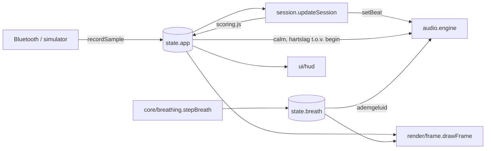
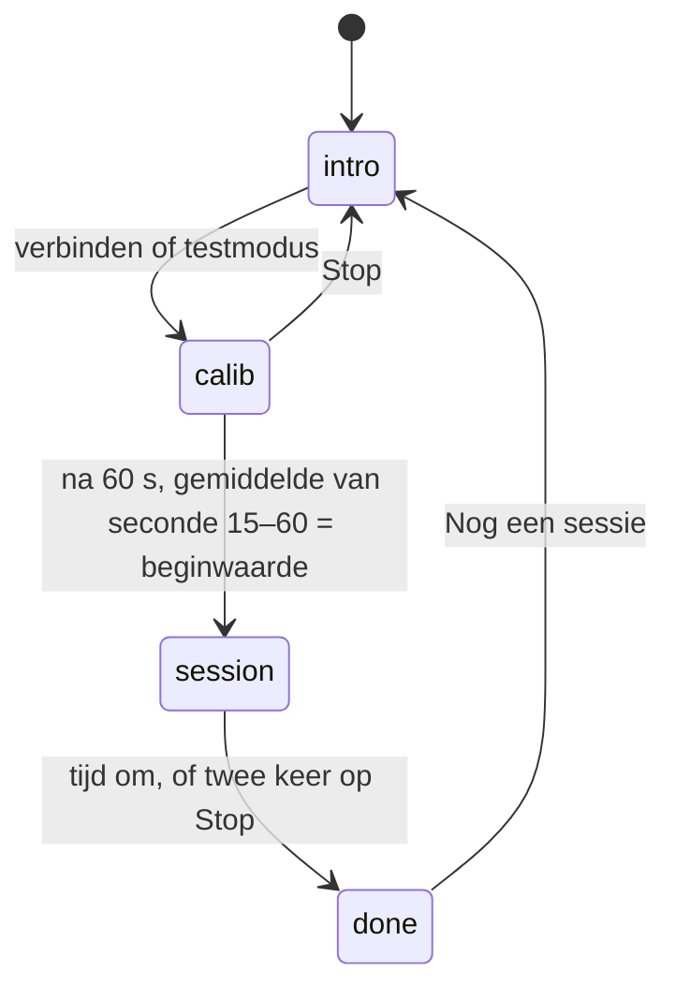

# Architectuur

## Uitgangspunten

- **Geen build-stap, geen dependencies.** De app bestaat uit native ES-modules die de browser direct laadt. Er valt niets te installeren, te upgraden of te bundelen, en GitHub Pages kan de repository zoals hij is publiceren. Voor een canvas-app van deze omvang levert een bundler of framework weinig op.
- **Pure logica gescheiden van de browser.** Alles wat rekent (scoring, ademhalingsritme, profielen) staat in `src/core` en `src/config`, zonder DOM, canvas of audio. Daardoor is het te testen met Node's ingebouwde test runner.
- **Eén gedeelde state.** `src/state.js` bevat één `app`-object. De sessie schrijft erin; scènes, HUD en audio lezen eruit. Bij deze omvang is dat overzichtelijker dan een event-systeem of store-library.
- **Alles gegenereerd.** Beeld (Canvas 2D) en geluid (Web Audio) worden volledig in code opgebouwd. Er zijn geen afbeeldingen of audiobestanden.

## Mappenstructuur

```
index.html              HTML-opbouw van de interface
src/
  main.js               startpunt: initialiseert modules, draait de animatielus
  state.js              gedeelde app-state, ademhalingsstate, hartslagmetingen
  session.js            sessieverloop: rustmeting → sessie → overzicht
  config/
    profiles.js         de vier profielen (scène, stijl, doel, binaural, oefeningen, teksten)
    breathing.js        ademhalingstechnieken als reeksen [fase, seconden]
  core/                 pure logica, getest
    math.js             clamp, lerp, easing, kleurhulpjes
    scoring.js          hartslag → rust, voortgang, binaural-tempo; samenvatting
    breathing.js        toestandsmachine van de ademgids
    storage.js          localStorage met fallback
  heart-rate/
    bluetooth.js        Web Bluetooth, Heart Rate Service (0x180D)
    simulator.js        testmodus
  audio/
    engine.js           Web Audio-engine: drone met binaural, lagen, effecten
    styles.js           muziekstijl per profiel
  render/
    context.js          canvas, schermmaat, tekenhulpjes
    frame.js            kiest de scène en tekent overlays
    breath-overlay.js   visuele ademgids (ring, vierkant, wisselende neusgaten)
    scenes/             lake.js, dawn.js, candle.js
  ui/                   knoppen, HUD, meldingen, ademhalingsbalk
  styles/main.css
tests/                  unit tests (node --test)
scripts/                lokale server, import-controle
```

## Datastroom per frame



`main.js` draait één `requestAnimationFrame`-lus die in vaste volgorde de sessie bijwerkt, de ademgids een stap verder zet, het beeld tekent, de HUD bijwerkt en de audio-parameters aanpast.

## Sessieverloop



- **Rustmeting (calib).** De binaural-zweving volgt live de hartslag via `profile.start(hr)`.
- **Sessie.** Elke frame berekent `scoring.js` uit het verschil met de beginwaarde drie dingen: *calm* (beeld en geluid), *rate* (voortgangspunten per seconde) en *lead* (hoe snel de zweving naar het doel van het profiel zakt). Bij een stijgende hartslag wordt *lead* negatief en schuift de zweving terug.
- **Voortgang.** Er zijn 7 stappen per sessie (lantaarns, toppen, cirkeldelen). Alle 7 halen vraagt gemiddeld een *rate* van 0,5 over de hele sessie.

## Audio

Elke drone-stem bestaat uit twee oscillatoren: één voor links, één voor rechts. De rechter is verstemd met de binaural-frequentie, zodat de zweving in de muziek zelf zit en niet als losse toon klinkt. De galm gebruikt per kanaal een eigen impulsrespons, zodat het binaurale beeld behouden blijft.

Bussen: `music`, `nature`, `pulse` en `breath`, elk met een eigen schuifje in het geluidspaneel. Alles loopt via een compressor naar de uitgang.

iOS: geluid start alleen na een tik. `audio.unlock()` wordt daarom synchroon in de klik-handler aangeroepen, nog vóór de bluetooth-kiezer. Een stil `<audio>`-element zorgt dat iOS de pagina als mediaweergave behandelt, zodat de stil-schakelaar het geluid niet dempt.

## Ontwerpkeuzes en afwegingen

| Keuze | Waarom | Afweging |
|---|---|---|
| Native ES-modules, geen bundler | geen dependencies of buildpipeline, direct publiceerbaar | ±25 kleine verzoeken bij de eerste keer laden; bij deze omvang geen merkbaar verschil |
| Canvas 2D in plaats van WebGL | eenvoudiger, ruim snel genoeg voor deze scènes | minder ruimte voor zware effecten |
| Eén mutable state-object | weinig code, makkelijk te volgen | modules zijn gekoppeld aan de vorm van `app` |
| JSDoc in plaats van TypeScript | geen compileerstap | geen afgedwongen typecontrole |
| Geschiedenis in localStorage | privé, geen backend nodig | niet gedeeld tussen apparaten |

## Mogelijke vervolgstappen

- Een PWA-manifest en service worker, zodat de app offline en als icoon op het beginscherm werkt (Bluefy ondersteunt dat beperkt).
- Tijd tussen hartslagen (RR-intervallen) uitlezen van een borstband, voor live HRV en adem-detectie.
- Sessiegeschiedenis exporteren of koppelen aan het gezondheidsdashboard.
