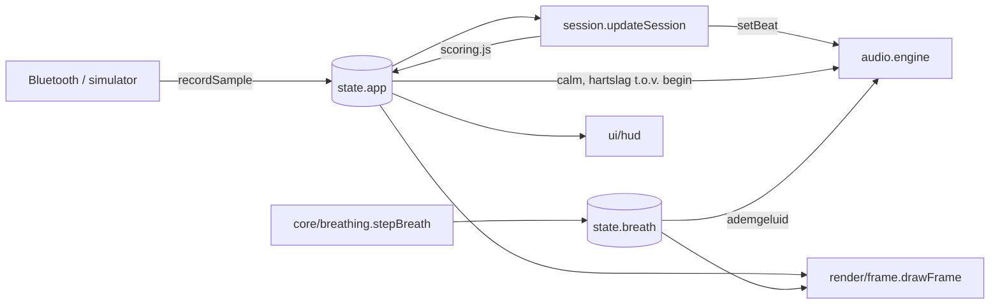
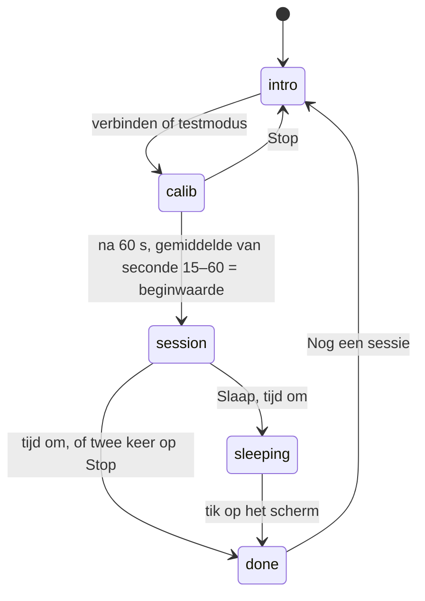

# Architectuur

## Uitgangspunten

- **Geen build-stap, geen dependencies.** De app bestaat uit native ES-modules die de browser direct laadt. Er valt niets te installeren, te upgraden of te bundelen, en GitHub Pages kan de repository zoals hij is publiceren. Voor een canvas-app van deze omvang levert een bundler of framework weinig op.
- **Pure logica gescheiden van de browser.** Alles wat rekent (scoring, ademhalingsritme, profielen) staat in `src/core` en `src/config`, zonder DOM, canvas of audio. Daardoor is het te testen met Node's ingebouwde test runner.
- **Eén gedeelde state.** `src/state.js` bevat één `app`-object. De sessie schrijft erin; scènes, HUD en audio lezen eruit. Bij deze omvang is dat overzichtelijker dan een event-systeem of store-library.
- **Alles gegenereerd.** Beeld (Canvas 2D) en geluid (Web Audio) worden volledig in code opgebouwd. Er zijn geen afbeeldingen of audiobestanden.

## Mappenstructuur

```
index.html              HTML-opbouw van de interface
src/
  main.js               startpunt: initialiseert modules, draait de animatielus
  state.js              gedeelde app-state, ademhalingsstate, hartslagmetingen
  session.js            sessieverloop: rustmeting → sessie → overzicht
  config/
    profiles.js         de profielen (scène, stijl, doel, binaural, oefeningen, teksten)
    breathing.js        ademhalingstechnieken als reeksen [fase, seconden]
  core/                 pure logica, getest
    math.js             clamp, lerp, easing, kleurhulpjes
    scoring.js          hartslag → rust, voortgang, binaural-tempo; samenvatting
    hrv.js              RR-intervallen: filteren, RMSSD, coherentie met de ademgids
    breathing.js        toestandsmachine van de ademgids
    storage.js          localStorage met fallback
  heart-rate/
    bluetooth.js        Web Bluetooth, Heart Rate Service (0x180D)
    simulator.js        testmodus
  audio/
    engine.js           Web Audio-engine: bussen, binaural-draaggolf, natuur, puls
    dsp.js              pure DSP: FFT, PADsynth, galm-impulsrespons, tapeverzadiging (getest)
    patches.js          de instrumentklanken, op de achtergrond berekend
    ambient.js          pads, luchtkoor, glaskorrels, dub-akkoorden, ruis en kraak
    groove.js           bas, filtersequence, klikjes en beat met tempo (focus en energie)
    space.js            galm, ping-pong-echo, 3D-banen rond je hoofd
    styles.js           muziekstijl per profiel
    fauna.js            dierengeluiden (krekel, uil, kikker, duiker, koekoek, specht, wolf …)
  render/
    context.js          canvas, schermmaat, tekenhulpjes
    frame.js            kiest de scène en tekent overlays
    breath-overlay.js   visuele ademgids (ring, vierkant, wisselende neusgaten)
    effects.js          optionele beeldeffecten (menu Beeld)
    scenes/             lake.js, dawn.js, candle.js, campfire.js
  ui/                   knoppen, HUD, meldingen, ademhalingsbalk, menu Beeld (fx-menu.js)
  styles/main.css
tests/                  unit tests (node --test)
scripts/                lokale server, import-controle
```

## Datastroom per frame



`main.js` draait één `requestAnimationFrame`-lus die in vaste volgorde de sessie bijwerkt, de ademgids een stap verder zet, het beeld tekent, de HUD bijwerkt en de audio-parameters aanpast.

## Sessieverloop



- **Rustmeting (calib).** De binaural-zweving volgt live de hartslag via `profile.start(hr)`.
- **Sessie.** Elke frame berekent `scoring.js` uit het verschil met de beginwaarde, volgens het doel van het profiel (`drop`, `steady` of `rise`), drie dingen: *calm* (beeld en geluid), *rate* (voortgangspunten per seconde) en *lead* (hoe snel de zweving naar het doel van het profiel zakt). Bij `drop` wordt *lead* negatief als je hartslag stijgt; bij `rise` (Energie) gebeurt dat juist boven de bovengrens van +15.
- **Voortgang.** Er zijn 7 stappen per sessie (lantaarns, toppen, cirkeldelen). Alle 7 halen vraagt gemiddeld een *rate* van 0,5 over de hele sessie.

## Beeldeffecten

`render/effects.js` bevat tien optionele effecten, elk met een schakelaar in het menu **Beeld** (`ui/fx-menu.js`). De keuze staat in localStorage onder `stilwater.fx`; standaard staan hartslag-rimpels, scène ademt mee en noorderlicht aan.

Elke scène levert via `focus()` een brandpunt `{x, y, flat, water, sky}`: het punt waar de effecten om draaien, hoe plat kringen op het water liggen, en waar water en open lucht zitten. Zo weten noorderlicht (alleen in de lucht) en lichtkringen (alleen op het water) waar ze mogen tekenen, en zijn effecten die bij een scène niet passen in het menu gedimd.

Volgorde per frame: *scène ademt mee* zet een schaal van 1 tot 3 % rond het brandpunt om de scène heen, dan de scène, dan de effecten achterin (noorderlicht, lichtkringen), dan die voorin (tunnel, lichtstroom, spiraal, caleidoscoop, mandala, rimpels, vonken), en daarna vignet, slaapdimming en ademgids.

Ontwerpregels: alles beweegt traag en gelijkmatig op adem of hartslag, met één middelpunt, en niets flitst of flikkert (flikkeren kan duizeligheid of aanvallen uitlokken). Zonder ademgids volgen de effecten een rustig ritme van zes keer per minuut; zonder borstband maken de rimpels hun ritme uit de gemiddelde hartslag.

## Audio

Alles wordt in code gemaakt; er zijn geen audiobestanden.

**Klank: PADsynth.** Kale oscillatoren klinken als "computer". De instrumenten (`patches.js`) worden daarom met PADsynth gemaakt (`dsp.js`). Elke boventoon is een smalle band frequenties met willekeurige fases, en één inverse FFT maakt daar een lus van ruim vijf seconden van die naadloos herhaalt. Dat klinkt als een ensemble: warm en levend, zonder dat de toonhoogte zweeft. Per oor wordt een eigen versie berekend, zodat het breed klinkt. De rechter is voor een deel met de linker gemengd, zodat het nooit hol wordt. De vier klanken (pad, warm, lucht, glas) worden bij het laden van de pagina op de achtergrond berekend, één tabel per keer. De muziek begint zodra ze klaar zijn.

**Lagen.**
- `ambient.js`: akkoorden die in elkaar overvloeien (oude stemmen vervagen terwijl nieuwe één voor één opkomen), een ademend luchtkoor, trage glaskorrels, gedempte dub-akkoorden in de echo (Ontspanning), taperuis en vinylkraak.
- `groove.js`: bas, een zaagtandsequence door een resonerend filter dat over 32 maten open- en dichtgaat, klikjes, en voor Energie een zachte downtempo-beat met sidechain op de pads. Het tempo is vast per stijl, of volgt je hartslag (schakelaar in het geluidspaneel); dan verschuift het hooguit 1 BPM per maat.

**Ruimte** (`space.js`). Een donkere galm van 9 seconden, gegenereerd met vroege reflecties en een staart waarin de hoge tonen sneller uitsterven dan de lage. Een dub-ping-pong-echo waarin elke herhaling donkerder en dunner wordt. En drie HRTF-banen die langzaam om je hoofd draaien, voor het luchtkoor en de glaskorrels. Dieren krijgen elk een vaste plek om je heen, soms achter je.

**Binaural.** De beat zit op een eigen zuivere draaggolf: links de toon, rechts de toon plus de beatfrequentie. Zo klopt de beat precies, terwijl de pads vrij kunnen klinken. Bij een stijlwissel vervaagt de draaggolf, springt in stilte naar de nieuwe toon en komt weer op.

Toonhoogtes glijden nooit. De hartslag stuurt de klankkleur (filter), niet de toonhoogte; dat voorkomt het "vinger op de plaat"-effect.

Het ademgeluid is roze ruis door een zacht laagdoorlaatfilter, en klinkt alleen terwijl de ademgids beweegt (stil bij vasthouden).

De muziekbus gaat door een zachte tapeverzadiging, die pieken afrondt in plaats van ze af te knippen.

Bussen: `music`, `nature`, `pulse` (hartslagpuls, of beat en klikjes bij een groove) en `breath`, elk met een eigen schuifje in het geluidspaneel. Alles loopt via een compressor naar de uitgang.

iOS: geluid start alleen na een tik. `audio.unlock()` wordt daarom synchroon in de klik-handler aangeroepen, nog vóór de bluetooth-kiezer. Een stil `<audio>`-element zorgt dat iOS de pagina als mediaweergave behandelt, zodat de stil-schakelaar het geluid niet dempt.

## Ontwerpkeuzes en afwegingen

| Keuze | Waarom | Afweging |
|---|---|---|
| Native ES-modules, geen bundler | geen dependencies of buildpipeline, direct publiceerbaar | ±30 kleine verzoeken bij de eerste keer laden; cache-versies via een import map die `npm run stamp` bijwerkt |
| Canvas 2D in plaats van WebGL | eenvoudiger, ruim snel genoeg voor deze scènes | minder ruimte voor zware effecten |
| Eén mutable state-object | weinig code, makkelijk te volgen | modules zijn gekoppeld aan de vorm van `app` |
| JSDoc in plaats van TypeScript | geen compileerstap | geen afgedwongen typecontrole |
| Geschiedenis in localStorage | privé, geen backend nodig | niet gedeeld tussen apparaten |

## Mogelijke vervolgstappen

- Een HRV-gestuurd doel voor de rustprofielen (voortgang uit stijgende HRV in plaats van alleen een dalende hartslag).

- Een PWA-manifest en service worker, zodat de app offline en als icoon op het beginscherm werkt (Bluefy ondersteunt dat beperkt).
- Sessiegeschiedenis exporteren of koppelen aan het gezondheidsdashboard.
